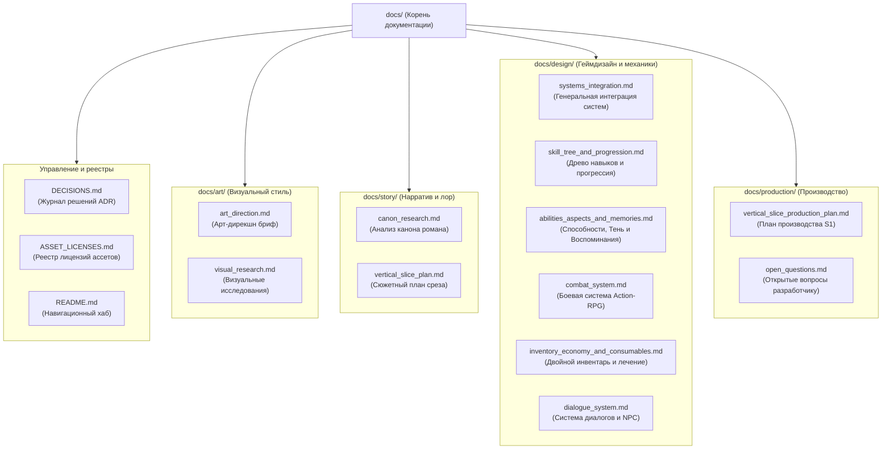

# Портал документации ShadowSlave

Добро пожаловать в репозиторий технической и геймдизайнерской документации проекта **ShadowSlave** (3D Action-RPG / Survival на Godot 4.7.2).

Этот каталог содержит нормативную документацию, архитектурные решения, концепции игровых подсистем, исследования первоисточника и производственные планы.

---

## 1. Архитектурная карта директории `docs/`

---

## 2. Каталог документов

### 2.1. Общепроектные реестры и архитектура (Корень `docs/`)
- [**`docs/DECISIONS.md`**](file:///c:/popa/docs/DECISIONS.md) — **Architecture Decision Records (ADR)**. Непрерывный хронологический журнал всех инженерных, архитектурных и технологических решений проекта (Milestone 1–12). *Обязателен для обновления согласно `AGENTS.md` при любых системных изменениях.*
- [**`docs/ASSET_LICENSES.md`**](file:///c:/popa/docs/ASSET_LICENSES.md) — **Реестр ассетов и лицензий**. Учёт источников, авторов, лицензий и ограничений для всех внешних 3D-моделей, текстур, звуков, шрифтов и плагинов движка.

### 2.2. Арт и визуальное оформление ([`docs/art/`](file:///c:/popa/docs/art/))
- [**`docs/art/art_direction.md`**](file:///c:/popa/docs/art/art_direction.md) — Базовый арт-дирекшн бриф: стилистика (мрачное реалистичное 3D), правила освещения, масштаб окружения, материалы реального мира и Царства Снов.
- [**`docs/art/visual_research.md`**](file:///c:/popa/docs/art/visual_research.md) — Визуальные исследования: анализ официальных обложек Webnovel, визуального языка персонажей и референсов окружения.

### 2.3. Сюжет, канон и нарратив ([`docs/story/`](file:///c:/popa/docs/story/))
- [**`docs/story/canon_research.md`**](file:///c:/popa/docs/story/canon_research.md) — Глубокий анализ первоисточника (роман *Shadow Slave* автора Guiltythree, главы 1–3): хронология событий до Кошмара, психология Санни, Заклинание и атрибуты.
- [**`docs/story/vertical_slice_plan.md`**](file:///c:/popa/docs/story/vertical_slice_plan.md) — Сюжетные рамки и границы вертикального среза пролога «Nightmare Begins» (вариант A: от скамейки до пробуждения в караване рабов).

### 2.4. Геймдизайн и игровые системы ([`docs/design/`](file:///c:/popa/docs/design/))
- [**`docs/design/systems_integration.md`**](file:///c:/popa/docs/design/systems_integration.md) — **Генеральная интеграция систем**: согласованный игровой цикл Action-RPG в стиле The Witcher 3, матрица владения данными (Single Source of Truth), реестр устраненных противоречий, дорожная карта от MVP до релиза и технические риски.
- [**`docs/design/skill_tree_and_progression.md`**](file:///c:/popa/docs/design/skill_tree_and_progression.md) — **Древо навыков и прогрессия**: бесуровневая ведьмачья модель на 4 ветки (Ближний бой, Дальний бой/ловкость, Теневое восприятие, Выживание), открытие очков через рубежи насыщения Ядра Души осколками и монолиты Заклинания.
- [**`docs/design/abilities_aspects_and_memories.md`**](file:///c:/popa/docs/design/abilities_aspects_and_memories.md) — **Способности, Аспекты и Воспоминания**: канонические атрибуты Санни, тактическая роль Тени (разведка, чутье, отвлечение врагов звуком, подготовка засад) и архитектура призыва Воспоминаний (`MemoriesVault`).
- [**`docs/design/combat_system.md`**](file:///c:/popa/docs/design/combat_system.md) — **Боевая система**: фазовая модель `MeleeAttack` с окном отмены замаха уклонением (Dash Cancel), запас прочности на 5–6 ударов, стелс-удары со спины (x3 урон) и минимальный набор из 8 анимационных клипов.
- [**`docs/design/inventory_economy_and_consumables.md`**](file:///c:/popa/docs/design/inventory_economy_and_consumables.md) — **Инвентарь, экономика и лечение**: модель двойного инвентаря (духовное Море Души vs походная сумка `SurvivalPouch`), постепенная регенерация HP от еды/настоек и редкие экстренные кристаллы исцеления из тайников.
- [**`docs/design/dialogue_system.md`**](file:///c:/popa/docs/design/dialogue_system.md) — **Диалоговая система**: выбор Гибридной Модели B, отражение Изъяна Санни [Clear Conscience] (запрет прямой лжи), архитектура узлов графа (`DialogueNode`, `DialogueChoice`) и менеджер сюжетных флагов `StoryMemory`.

### 2.5. Планирование и управление проектом ([`docs/production/`](file:///c:/popa/docs/production/))
- [**`docs/production/vertical_slice_production_plan.md`**](file:///c:/popa/docs/production/vertical_slice_production_plan.md) — Пошаговый производственный план реализации вертикального среза S1 (биты B01–B16), режимы управления (FREE, LOOK, LOCKED, CHAINED), риски и критерии приёмки.
- [**`docs/production/open_questions.md`**](file:///c:/popa/docs/production/open_questions.md) — Пакет открытых вопросов и развилок для ведущего разработчика (прогрессия ядра, боевые механики Тени, летальность и специфика выживания).

---

## 3. Стандарты ведения документации

1. **Единое место хранения:** Вся проектная документация располагается строго внутри директории `docs/`. Создание «зеркал» или разрозненных `.md` файлов в корне проекта запрещено.
2. **Именование файлов:**
   - Для специализированных разделов используется формат `snake_case.md` без случайных числовых индексов (например: `dialogue_system.md`, а не `13_dialogue_system.md`).
   - Общепроектные ключевые реестры верхнего уровня именуются заглавными буквами: `DECISIONS.md`, `ASSET_LICENSES.md`, `README.md`.
3. **Кросс-ссылки:** Ссылки между документами оформляются относительными путями (или Markdown-ссылками с префиксом `docs/...`).
4. **Фиксация решений:** Все утверждённые концептуальные решения в обязательном порядке фиксируются датированными записями в [`docs/DECISIONS.md`](file:///c:/popa/docs/DECISIONS.md) со ссылкой на соответствующий документ в `docs/design/` или `docs/production/`.
5. **Баланс и данные игры:** Документация описывает концепцию и правила; сами численные балансные характеристики и конфигурации должны храниться строго в типизированных Godot Resources (`.tres`) в папке `resources/`, как предписано в `AGENTS.md`.
