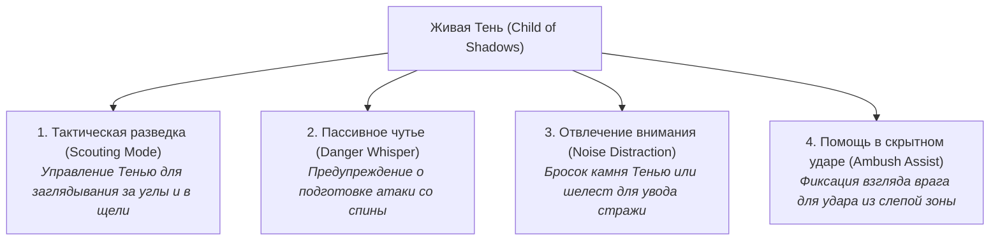
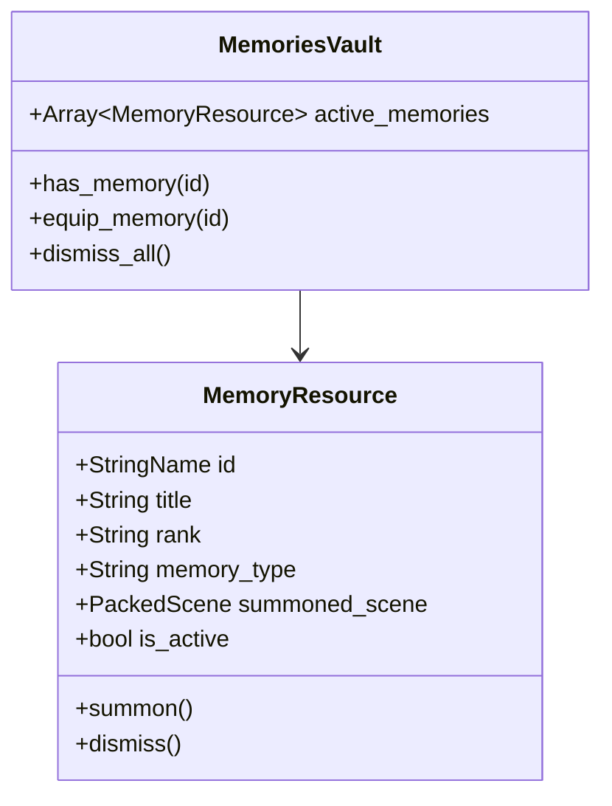

# Дизайн-документ: Способности, Аспекты и Воспоминания (Abilities, Aspects & Memories)

**Проект:** Shadow Slave (3D Action-RPG / Survival)  
**Статус:** Утверждено ведущим разработчиком (Этап 12, Milestone 9)  
**Файл документа:** `docs/design/abilities_aspects_and_memories.md`  
**Опорные документы:**
- `docs/DECISIONS.md` — журнал архитектурных решений;
- `docs/production/open_questions.md` — решения по боевой роли Тени;
- `docs/story/canon_research.md` — исследование канона Аспектов, рун и Изъяна;
- `docs/design/systems_integration.md` — общая архитектура интеграции систем.

---

## 1. Канонические сущности персонажа (Канон Заклинания)

В Первом Кошмаре Санни получает от Заклинания жестко зафиксированный канонический статус ([StatusSheet](file:///c:/popa/scripts/spell/status_sheet.gd#L1-L14)):

| Параметр | Каноническое значение | Геймплейная роль |
|---|---|---|
| **Имя (Name)** | *Sunless (Санлесс)* | Истинная идентичность |
| **Истинное имя (True Name)** | *— (Отсутствует)* | Открывается в конце Кошмара |
| **Ранг (Rank)** | *Aspirant (Аспирант)* | Начальный статус претендента |
| **Ядро души (Soul Core)** | *Dormant (Спящее)* | Нет доступа к магии и Эссенции Души |
| **Атрибут: [Fated]** | *Обречённый / Связанный судьбой* | Притягивает невероятные опасности и редкие возможности |
| **Атрибут: [Mark of Divinity]** | *Знак Божественности* | Пассивное сопротивление ментальному давлению |
| **Атрибут: [Child of Shadows]** | *Дитя Теней* | Дарует зрение в темноте и живую самостоятельную Тень |
| **Аспект (Aspect)** | *[Temple Slave] (Храмовый раб)* | Скрывает истинную божественную природу раба теней |
| **Изъян (Flaw)** | *[Clear Conscience] (Чистая совесть)* | Физический запрет на ложь; основа всей диалоговой системы |

---

## 2. Разделение канонических сущностей и мирских навыков

Критически важно не смешивать в одну кучу канонические черты Заклинания и обычные боевые техники:
1. **Канонические атрибуты и Аспект (Неизменяемое ядро):**
   - Даются Заклинанием раз и навсегда;
   - Задают фундаментальные правила взаимодействия персонажа с миром (невозможность лгать, наличие живой Тени, зрение в темноте).
2. **Мирские навыки выживания и боя (Древо навыков):**
   - Техники, которые Санни развивает тренировкой и практикой (мастерство ножа, скрытность, выносливость, настойки).

---

## 3. Живая Тень Санни как тактический ассистент

В соответствии с утвержденным **Вариантом A**, Тень в Первом Кошмаре не кастует боевых заклинаний и не имеет шкалы маны. Тень — это физически проявленный теневой спутник со следующими функциями:

### Ресурсная модель способностей
Поскольку у Санни со Спящим Ядром **нет Эссенции Души**, поддержание активных теневых действий расходует обычную **Физическую Выносливость (Stamina)** из-за ментального напряжения героя.

---

## 4. Архитектура Воспоминаний (Memories Vault)

Воспоминания — это не физические предметы, лежащие в мешке. Это магические конструкции, хранящиеся в Море Души.

### Правила призыва Воспоминаний
- Призыв оружия ([Осколок Полуночи] и др.) происходит мгновенно по горячей клавише или по входу в боевой режим;
- Воспоминание материализуется из вспышки черных искр света и ложится в руку персонажа;
- При отзыве оружие мгновенно растворяется;
- Воспоминания не имеют веса и не занимают физические слоты сумки `SurvivalPouch`.

---

## 5. Градация внедрения: Необходимое vs Желательное vs Будущее

- **MVP (Ближайший играбельный срез S2):**
  - Экран статуса Заклинания `RuneStatusUI` с каноническими рунами;
  - Тень как привязанный узел-спутник, повторяющий движения персонажа;
  - Призыв одного базового Воспоминания (нож/клинок) в руку через `MemoriesVault`.
- **Качественное демо (S3–S4):**
  - Режим отделения Тени для разведки за углами (переключение ракурса камеры);
  - Отвлекающий свист/шум Тени для управления ИИ врагов;
  - Визуальные эффекты черного мерцания при материализации Воспоминаний.
- **Долгосрочно (Пост-демо / Релиз):**
  - Пробуждение Аспекта [Shadow Slave] после Первого Кошмара;
  - Появление шкалы Эссенции Души;
  - Окутывание тела Тенью (Shadow Augmentation) для колоссального прироста силы.
