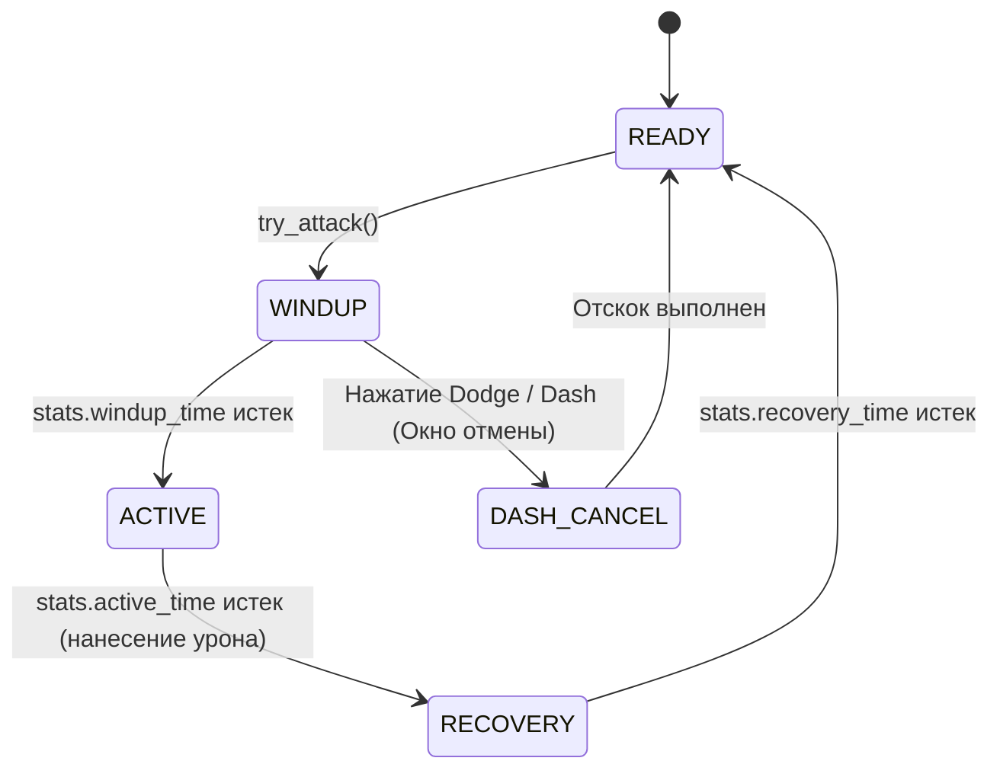

# Дизайн-документ: Боевая система (Combat System)

**Проект:** Shadow Slave (3D Action-RPG / Survival)  
**Статус:** Утверждено ведущим разработчиком (Этап 12, Milestone 9)  
**Файл документа:** `docs/design/combat_system.md`  
**Опорные документы:**
- `docs/DECISIONS.md` — решения Milestone 2, 2.1, 4 (фазы атаки, хёртбоксы);
- `docs/production/open_questions.md` — решения по динамике и сложности боя;
- `docs/design/systems_integration.md` — системная интеграция.

---

## 1. Концепция боя: Action-RPG в стиле The Witcher 3

Боевая система Shadow Slave строится на принципах **отзывчивого Action-RPG с элементами выживания и повышенной сложностью**, вдохновленной боевкой *The Witcher 3*:
- **Не хардкорный Soulsborne:** Отсутствуют фрустрирующие ваншоты и удушающий дефицит сил.
- **Умеренная цена ошибки:** Базовый запас прочности Санни рассчитан в среднем на **5–6 ударов рядового противника**.
- **Тактическая свобода и вариативность:** Игрок может побеждать через прямой маневренный бой, через скрытную ликвидацию из тени (стелс) или через подготовку ловушек и дистанционное отвлечение.

---

## 2. Фазовая модель удара и отзывчивое управление

Существующая в проекте фазовая архитектура `MeleeAttack` ([scripts/combat/melee_attack.gd](file:///c:/popa/scripts/combat/melee_attack.gd)) дополняется механизмом прерывания для обеспечения ведьмачьей плавности:

1. **WINDUP (Подготовка):** Замах оружия. Направление удара фиксируется. В первой половине фазы игрок может **прервать замах уклонением (Dash)**, спасаясь от внезапной контратаки.
2. **ACTIVE (Активное окно):** Зона поражения проверяет пересечения с `Hurtbox` цели. Не более одного попадания по каждой цели за удар.
3. **RECOVERY (Восстановление):** Доводка оружия. Управление движением частично восстанавливается.

---

## 3. Минимальный анимационный пакет (Борьба со Scope Creep)

Чтобы не попасть в производственную ловушку сотен мокап-анимаций, для Санни утверждается **строго минимальный набор из 8 базовых клипов**:

| Действие | Анимационный клип | Назначение |
|---|---|---|
| **Быстрый выпад** | `1H_Attack_Light_Slash` | Основной быстрый удар ножом/кинжалом |
| **Силовой выпад** | `1H_Attack_Heavy_Thrust` | Тяжелый удар с увеличенным windup |
| **Уклонение (Dash)** | `Dodge_Hop` / `Step_Back` | Быстрый шаг/отскок в сторону (с окном i-frames 0.2 с) |
| **Блок оружием** | `1H_Block_Pose` | Снижение входящего урона на 50% с расходом выносливости |
| **Стелс-удар** | `Stealth_Stab` | Критический удар со спины нетревожного врага |
| **Получение урона** | `Hit_Light` | Краткая реакция на удар (не прерывает активное окно) |
| **Истощение** | `Exhausted_Gasp` | Снижение скорости при нулевой выносливости |
| **Смерть** | `Death_A` | Падение персонажа при гибели |

---

## 4. Стелс и атаки из засады

- **Восприятие ИИ противников (`TestEnemy`):**
  - Конус зрения: 90 градусов перед моделью, дальность 12 метров;
  - Радиус слуха: 4 метра при обычном беге, 1 метр при шаге крадучись.
- **Смертоносный удар со спины (Backstab):**
  - Если Санни атакует противника, находясь сзади вне конуса зрения, наносится **критический урон (множитель x3)**;
  - Для рядовых слабых врагов это приводит к мгновенной ликвидации.

---

## 5. Выносливость (Stamina) и ее баланс

- Компонент `StaminaComponent` управляет пулом выносливости (база 100 ед.).
- **Расход:**
  - Быстрый удар: 15 ед.;
  - Тяжелый удар: 30 ед.;
  - Уклонение (Dash): 20 ед.;
  - Спринт: 10 ед./сек.
- **Регенерация:** Стартует через 0.8 секунды после завершения действия, восстанавливая 35 ед./сек.
- **Нулевая выносливость:** Не лишает управления полностью, а блокирует спринт и тяжелые удары, заставляя игрока на секунду разорвать дистанцию.

---

## 6. Градация внедрения: Необходимое vs Желательное vs Будущее

- **MVP (Ближайший играбельный срез S2):**
  - Компонент `StaminaComponent` и привязка к существующему `MeleeAttack`;
  - Маневренный Dash по клавише Space/Shift с окном i-frames;
  - Возможность прерывания замаха отскоком;
  - Настройка здоровья Санни на 5–6 ударов противника.
- **Качественное демо (S3–S4):**
  - Стелс-удар со спины с троекратным уроном;
  - Простая система восприятия ИИ врагов (слух/зрение);
  - Индикатор опасности при подготовке вражеского удара.
- **Долгосрочно (Пост-демо / Релиз):**
  - Парирование ударов в точный тайминг с контратакой;
  - Разные боевые стойки и стили для меча, копья и безоружного боя.
