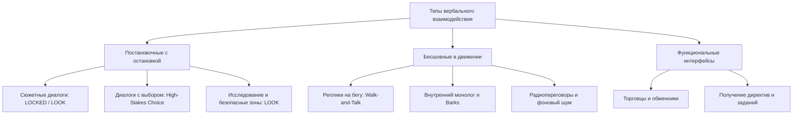
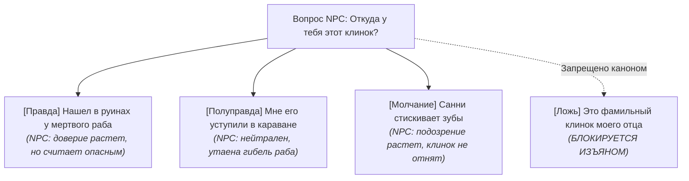
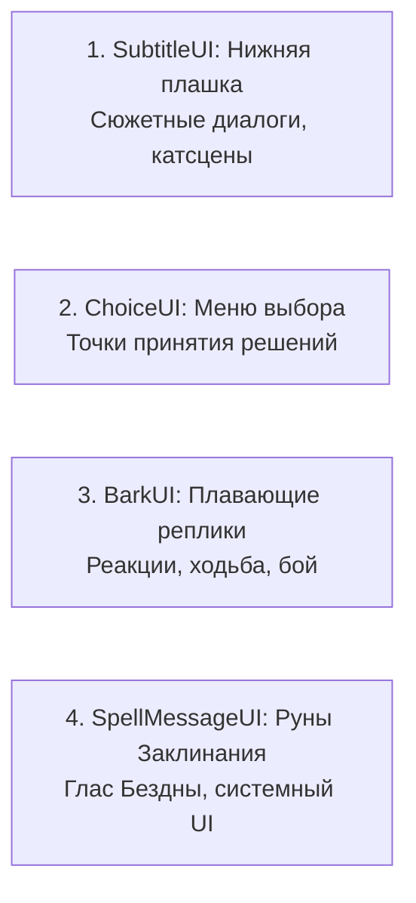
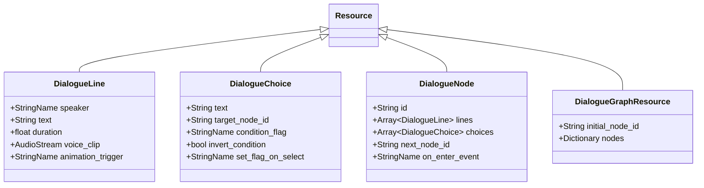
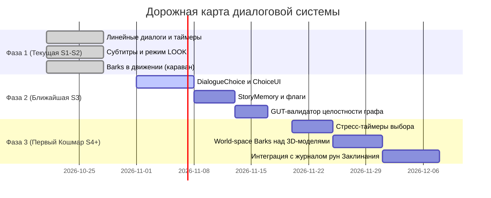

# Дизайн-документ: Концепция диалогов и взаимодействия с NPC

**Проект:** Shadow Slave (3D Action-RPG / Survival)  
**Этап разработки:** Этап 10 (Milestone 7)  
**Статус документа:** Концепция утверждена к поэтапной реализации  
**Файл документа:** `docs/design/dialogue_system.md`  
**Опорные документы:**
- `docs/DECISIONS.md` — решения архитектуры Godot 4.7.2;
- `docs/story/canon_research.md` — исследование первоисточника и специфика протагониста;
- `docs/story/vertical_slice_plan.md` и `docs/production/vertical_slice_production_plan.md` — план среза «Nightmare Begins»;
- `scripts/dialogue/*` и `scripts/ui/subtitle_ui.gd` — текущая реализация диалогов.

---

## 1. Контекст проекта и главный вопрос

### 1.1. Главный вопрос этапа
> **Нужна ли игре отдельная система диалогов с полноценными деревьями реплик (CRPG-стиль) или достаточно минимального инструмента для постановки разговоров?**

Для ответа на этот вопрос необходимо проанализировать три фактора: специфику первоисточника *Shadow Slave*, жанровую идентичность игры и текущие производственные ограничения команды.

### 1.2. Специфика Shadow Slave и протагониста (Санни)
1. **Тон и темп:** По авторскому определению Guiltythree, атмосфера мира ближе к Dark Souls и мрачной антиутопии. Это суровый survival, где разговор — не праздное развлечение, а редкая, напряженная передышка или отчаянная борьба за жизнь.
2. **Характер Санни (Sunless):** Санни — выходец из трущоб Окраин NQSC (Northern Quadrant Siege Capital). Он крайне осторожен, подозрителен, циничен, скрытен и прагматичен. Он не бросается спасать мир и не произносит пафосных речей.
3. **Фундаментальное ограничение — Изъян (Flaw): [Clear Conscience] (Чистая совесть):**
   В Первом Кошмаре Санни получает Аспект [Temple Slave] и Изъян, который **физически запрещает ему лгать**. На прямой вопрос Санни обязан сказать правду. Его мастерство выживания строится на:
   - умолчаниях и полуправде;
   - сарказме и метафорах;
   - уклонении от прямого ответа и встречных вопросах;
   - дезинформации через правду, истолкованную превратно.
   Классическая механика ветвления диалогов с кнопками `[Ложь]` или случайными фразами ломает канон и разрушает уникальную идентичность персонажа.
4. **Фатализм и атрибут [Fated] (Обречённый):**
   Судьба связывает Санни цепью неизбежных испытаний. Общая траектория сюжета имеет жесткие ключевые вехи, поэтому бесконечное ветвление сюжета с десятками концовок входит в прямое противоречие с каноном.
5. **Текущее состояние проекта (S1 Graybox):**
   В кодовой базе уже функционирует легковесный модуль диалогов:
   - `DialogueLine` (`.tres`) — атомарная реплика с указанием говорящего, текста и длительности (0 = ожидание ввода, >0 = таймер);
   - `DialogueSequence` (`.tres`) — линейный контейнер реплик;
   - `DialogueRunner` — управляющий узел с поддержкой сигналов, быстрым тестовым режимом `fast_mode` и защитой от случайного скипа на первом кадре;
   - `SubtitleUI` — отображение имени, текста и подсказки перехода;
   - Режимы камеры и контроллера: `FREE`, `LOOK` (свободный обзор головой в диалоге), `LOCKED` (катсцена), `CHAINED` (шаг в караване).

---

## 2. Сравнительный анализ трех моделей

Рассмотрим три архитектурных подхода к организации диалогов в игре:

### 2.1. Модель A. Повествовательные сцены и линейные диалоги
Речь, действия и переходы строго управляются режиссурой. Игрок инициирует диалог или он запускается триггером сцены, но вариантов реплик нет. Игрок только нажимает «Далее» либо реплики идут по таймеру во время движения/постановки.

- **Преимущества:**
  - 100% контроль автора и сценариста над драматическим темпом, паузами, режиссурой камеры и эмоциональным накалом.
  - Канонический образ Санни остается кристально чистым: ни одной нехарактерной реплики, идеальное соблюдение Изъяна.
  - Минимальная стоимость разработки: движок уже готов (`DialogueSequence`), не требуется писать редакторы графов, UI выбора и системы сохранения ветвящихся состояний.
  - Нулевой риск комбинаторного взрыва сюжетных багов; элементарное тестирование через GUT.
- **Недостатки:**
  - Пассивность игрока: в разговорах нет ощущения собственного выбора (агентности), игра временами превращается в визуальную новеллу или кино.
  - Нулевая вариативность и слабая реиграбельность диалоговых сцен.
  - Невозможность реализовать отыгрыш тактической хитрости Санни (когда игрок сам решает, промолчать или задать колкий вопрос).
- **Соответствие Shadow Slave:** Идеально для Пролога (B01–B16), где Санни находится в жестких рамках обстоятельств (допрос дежурным, брифинг седого полицейского, цепь каравана). Однако для полноценной игры в Кошмаре и лагере рабов модель ощущается излишне сковывающей.
- **Стоимость разработки и QA:** Очень низкая (1/5).
- **Постановка:** Максимальная кинематографичность.
- **Риск лишней работы (Scope Creep):** Нулевой.
- **Пригодность к расширению:** Низкая — система не имеет задела под решения игрока.

### 2.2. Модель B. Минимальная и контекстная система выбора
Большинство диалогов и реплик остаются линейными и кинематографичными. Выбор предоставляется игроку только в **узловых контекстных моментах**, когда решение имеет ощутимые последствия:
- тактический выбор (что узнать в первую очередь в условиях ограниченного времени);
- социальный выбор с учетом Изъяна (промолчать, съязвить, ответить чистую правду или увести разговор в сторону);
- выбор действия/компромисса (поделиться ресурсом, рискнуть ради информации, вмешаться в конфликт рабов).

- **Преимущества:**
  - Высокая ценность каждого выбора: отсутствует иллюзия ветвления ради ветвления, игрок знает, что если выбор появился — он важен.
  - Полное сохранение кинематографичности и высокого темпа повествования (диалоги не превращаются в опросники из 10 пунктов).
  - Органичное включение механики Изъяна Санни: варианты реплик отражают способы манипуляции правдой, доступные герою.
  - Контролируемый объем разработки: дерево не разрастается экспоненциально, ветки быстро схлопываются обратно в основной стержень, меняя лишь флаги состояния мира, отношения или получаемые предметы/память.
  - Предсказуемое тестирование: легко покрывается юнит- и интеграционными тестами в GUT.
- **Недостатки:**
  - Требует высочайшего качества сценарной работы: каждый выбор обязан иметь видимый отклик, иначе игрок разочаруется.
  - Меньшая глубина отыгрыша по сравнению с классическими «песочницами» (нельзя отыграть принципиально другого персонажа, кроме Санни).
- **Соответствие Shadow Slave:** Максимальное (5/5). Отвечает формуле «сюжетно-ориентированный survival с тактической свободой».
- **Стоимость разработки и QA:** Умеренная (2.5/5).
- **Постановка:** Очень высокая, бесшовно сочетает катсцены, геймплей и краткие развилки.
- **Риск лишней работы (Scope Creep):** Низкий при соблюдении дисциплины дизайна («выбор только там, где есть реальное последствие»).
- **Пригодность к расширению:** Отличная: базовый линейный раннер плавно дополняется узлом ветвления (`ChoiceNode`), не ломая существующие ресурсы.

### 2.3. Модель C. Полноценные ветвящиеся диалоги (CRPG-стандарт)
Глубокие графы с развилками, опросными меню («расскажи мне о себе», «где я?», «что это за место?»), проверками характеристик, скрытыми бросками кубиков и десятками взаимоисключающих сюжетных путей (уровня *Baldur's Gate 3*, *Pillars of Eternity* или *Fallout: New Vegas*).

- **Преимущества:**
  - Предельная свобода отыгрыша, глубокое исследование лора через выспрашивание каждого NPC.
  - Колоссальная реиграбельность диалогов.
- **Недостатки:**
  - Экспоненциальный рост трудозатрат: 70–80% написанного и озвученного контента среднестатистический игрок никогда не увидит.
  - Критическое падение темпа: динамичный 3D survival превращается в стояние на месте и чтение простыней текста.
  - Риск размытия характера Санни: возможность выбора шаблонных добрых/злых реплик уничтожит аутентичность персонажа.
  - Катастрофическая сложность тестирования: комбинаторный взрыв флагов, гарантированные тупики (deadlocks) и сломанные сюжетные линии.
  - Необходимость внедрения тяжелых сторонних аддонов (например, Dialogic 2), которые были сознательно отложены в `DECISIONS.md`.
- **Соответствие Shadow Slave:** Низкое (1.5/5). Противоречит духу одинокого и смертоносного Кошмара.
- **Стоимость разработки и QA:** Экстремально высокая (5/5). Неподъемна для инди/компактной команды.
- **Постановка:** Низкая — обычно статичные «говорящие головы» напротив камеры.
- **Риск лишней работы (Scope Creep):** Критический. Главный источник производственного ада.
- **Пригодность к расширению:** Избыточна и опасна для текущей фазы проекта.

### 2.4. Сводная таблица сравнения

| Критерий | Модель A (Линейная) | Модель B (Минимальный выбор) | Модель C (Глубокое дерево) |
|---|---|---|---|
| **Соответствие канону Shadow Slave** | Высокое (для катсцен) | **Идеальное (сюжет + тактика)** | Низкое (ломает характер Санни) |
| **Отражение Изъяна [Flaw]** | Фиксированное | **Интерактивное (выбор правды)** | Сложно контролируемое |
| **Стоимость разработки** | Очень низкая | **Умеренная** | Экстремально высокая |
| **Сложность QA-тестирования** | Минимальная (GUT) | **Контролируемая (GUT)** | Комбинаторный взрыв |
| **Влияние на темп игры** | Не сбивает темп | **Сохраняет напряжение** | Полностью останавливает темп |
| **Кинематографичность постановки** | Максимальная | **Очень высокая** | Средняя / низкая |
| **Реиграбельность** | Нулевая | **Целевая (тактическая)** | Высокая |
| **Риск срыва сроков (Scope Creep)** | Нулевой | **Низкий** | Критический |

### 2.5. Выбор проекта: Гибридная Модель B («Кинематографический нарратив + тактические контекстные выборы»)

**Решение:** Для игры Shadow Slave принимается **Модель B в виде сбалансированного гибрида**.

**Компоненты гибридной модели:**
1. **Линейная сценарная основа (наследие Модели A):**
   - Пролог, сюжетные интродукции, брифинги, переходы между актами и драматические кульминации режиссируются линейно. Игрок сохраняет управление камерой (режим `LOOK`) или погружается в постановочную сцену (`LOCKED`), продвигая текст клавишей взаимодействия.
2. **Точечные узлы выбора (Divergence Nodes):**
   - Возникают исключительно в ситуациях, когда Санни поставлен перед тактической, моральной или социальной дилеммой.
   - Количество вариантов: строго 2 или 3.
   - Все варианты валидны с точки зрения Изъяна (нет невозможной лжи).
3. **Бесшовные реплики на ходу (Ambient Barks & Walk-and-Talk):**
   - Короткие фразы, комментарии и переговоры подаются без остановки движения игрока (режим `FREE` или `CHAINED`), не блокируя ввод.
4. **Контекстные взаимодействия:**
   - Вместо диалогового меню выбора темы («Спросить про город», «Спросить про монстров») информация подается через взаимодействие с предметами в мире (осмотр кандалов, взгляд на раненого раба, изучение рун).

---

## 3. Классификация и режиссура типов разговоров

Все вербальные взаимодействия в игре делятся на 8 типов с четкими правилами UX, камеры и влияния на геймплей.

### 3.1. Сюжетные диалоги (Story Cutscene Dialogues)
- **Примеры:** Разговор с дежурным офицером в участке (B08), допрос в изоляторе седым полицейским (B11–B12), диалог с Нефис у костра в Кошмаре.
- **Режим управления:** `LOOK` (свободный или ограниченный обзор головой, симулирующий шею) или `LOCKED` (кинематографический план).
- **UX:** Полноразмерная диалоговая панель в нижней трети экрана, контрастный текст, имя говорящего, индикатор ожидания ввода.
- **Пейсинг:** Игрок продвигает реплики клавишей `advance_dialogue` (E / Пробел / ЛКМ).
- **Прерывание:** Не прерывается геймплеем; доступен пропуск всей сцены целиком при повторном прохождении.

### 3.2. Разговоры при исследовании (Exploration Dialogues)
- **Примеры:** Разговор со случайным рабом на привале каравана, изучение странного силуэта в руинах, общение со спутниками в безопасной зоне.
- **Режим управления:** `LOOK` с привязкой взгляда к собеседнику (мягкий доворот камеры, но без жесткого лока).
- **UX:** Субтитры над персонажем или компактная панель.
- **Пейсинг:** Короткие обмены репликами (2–4 фразы). Возможность выйти из разговора, просто отойдя назад (нажав S / отойдя за радиус взаимодействия).

### 3.3. Короткие реплики и комментарии персонажа (Barks & Inner Monologues)
- **Примеры:** «Горько… лучше бы купил мяса» (B02), «Надувательство» (B03), реакция на холод ветра, кровоточащие ступни, обнаружение следов монстра.
- **Режим управления:** `FREE` (полное сохранение контроля) или `CHAINED` (шаг в караване).
- **UX:** Плавающие реплики (overhead world-space / HUD) в нижней центральной части экрана, без затемнения фона, не перекрывающие прицел и окружение. Длительность 2.5–4.5 с.
- **Пейсинг:** Полностью автоматические (таймерные). Никаких нажатий клавиш для закрытия.

### 3.4. Разговоры с торговцами и обменниками (Vendor Interactions)
- **Примеры:** Скупщик краденого на окраине, обмен осколков душ в святилище, подпольный торговец в лагере.
- **Режим управления:** Вход по `interact` (E) -> переход в функциональный UI торговли/крафта.
- **UX:** Отдельный экран инвентаря/обмена. Торговец произносит 1 приветственную реплику (аудио/текст) и 1 прощальную.
- **Правило:** Никаких многоуровневых диалоговых веток перед входом в магазин. Доступ к товарам происходит мгновенно.

### 3.5. Диалоги, влияющие на отношения (Relationship & Trust Dialogues)
- **Примеры:** Диалоги с Нефис, Касси, рабом-соседом в караване.
- **Специфика:** Реакция NPC зависит от того, какую стратегию выбрал Санни: циничное безразличие, скрытное содействие, язвительное предупреждение или прямое признание своей слабости.
- **Механика:** Изменение скрытых счетчиков доверия/подозрительности (`Trust` / `Suspicion`).
- **Визуализация:** Отсутствуют явные «плюсики кармы» (в стиле «Нефис это запомнит»). Реакция считывается через смену позы, взгляда, последующие фразы и готовность NPC прикрыть спину в бою.

### 3.6. Разговоры, открывающие задания (Quest Dialogues)
- **Примеры:** Третья специальная директива дежурного, поручение надсмотрщика каравана, задание на разведку пещеры.
- **UX:** Диалог подводит к цели, после завершения в правом верхнем углу появляется лаконичное системное уведомление Заклинания или памятка в журнале рун.
- **Правило:** Диалог не дублирует журнал заданий длинными списками условий. Вся конкретика фиксируется в интерфейсе рун.

### 3.7. Выборы с последствиями (High-Stakes Decision Points)
- **Примеры:** Решение в изоляторе (какие вопросы задать полицейскому до того, как накатит сонливость), решение в караване (спрятать найденный каменный осколок или отдать рабу), тактика в Первом Кошмаре.
- **UX:** Остановка таймера или мягкий стресс-таймер (виньетка сонливости/сердцебиения); четкий список из 2–3 вариантов ответа; выбор осуществляется клавишами 1-2-3 или стрелками / колесом мыши с подтверждением.
- **Последствия:** Немедленные (изменение сцены/инвентаря) или отложенные (встреча в следующей главе).

### 3.8. Диалоги во время движения и экшена (Walk-and-Talk / Radio)
- **Примеры:** Голос напарника во время бегства от Существа Кошмара, перекличка офицеров при тревоге Code Black, переговоры караванщиков на марше.
- **Режим управления:** Полный `FREE` (бег, уклонения, бой).
- **UX:** Компактный радио-/шепот-стиль субтитров с иконкой источника звука сбоку. При получении урона персонаж прерывается вскриком, после боя реплика не повторяется глупо заново, а сменяется краткой сводкой («Ты цел? Уходим!»).

---

## 4. Условия, последствия и логика выбора

### 4.1. Философия выбора: Принцип «Никаких ложных развилок» (Zero Fake Choices)
В классических RPG часто встречается псевдовыбор:
1. «Да, я помогу тебе»
2. «Ладно, но только за деньги»
3. «У меня нет выбора, говори, что делать»
Все три варианта ведут к одной и той же реплике NPC. В *Shadow Slave* такой подход **запрещен**.

**Правило дизайна Shadow Slave:**
> Если варианты ответа не меняют знание игрока, отношение собеседника, доступность ресурсов или тактическую обстановку — выбор не предоставляется вообще. В таких сценах диалог делается линейным и высокорежиссированным.

### 4.2. Допустимые типы вариантов ответа с учетом Изъяна
Каждый узел выбора строится вокруг уникального характера Санни:
1. **[Прямота]:** Сказать чистую правду (часто жесткую, неприятную или раскрывающую слабость).
   *Пример:* «Я родился во время затмения, семьи у меня нет, выживать я не умею».
2. **[Уклончивость / Полуправда]:** Сказать правду, но умолчать о главном или сформулировать мысль двусмысленно.
   *Пример:* «Я просто бродяга, который ищет ночлег» (формально правда, но скрывает знание о Кошмаре).
3. **[Сарказм / Провокация]:** Перевести внимание собеседника на его собственные слабости, не сказав ни слова лжи.
   *Пример:* «А у вас отличная броня. Надеюсь, она спасет вас, когда я усну».
4. **[Молчание / Наблюдение]:** Сознательный отказ от ответа. Санни закрывает рот, чтобы Изъян не вынудил его выдать критическую тайну.

### 4.3. Проверка условий доступности (Conditions)
Условия определяют, появится ли вариант ответа в списке или будет ли он заблокирован:
- `has_flag(flag_name)` — проверка сюжетного флага в `StoryMemory` (например, `knows_about_code_black`);
- `has_item(item_id)` — наличие предмета или осколка души;
- `has_attribute(attr_id)` — проверка ранга или атрибутов Санни ([Fated], [Mark of Divinity]);
- `stat_check(stat, value)` — уровень скрытности, физического истощения или рассудка.

### 4.4. Регистрация последствий (Consequences & Side Effects)
Выбор игрока инициирует транзакцию изменений:
1. **Флаги фактов (Fact Database):** Запись события (`helped_slave_in_caravan = true`).
2. **Влияние на следующую сцену:** В следующей локации спасенный раб не шумит и не привлекает монстра, либо надсмотрщик замечает пропажу пайка.
3. **Выдача памяти/предметов:** При получении информации Заклинание может зафиксировать осколок знания.

### 4.5. Прерывание диалога, возвраты, смерть и откаты
- **Прерывание движением:** Если игрок отошел от NPC во время обычного разговора исследования, диалог закрывается. При повторном подходе NPC произносит контекстную реплику возврата («Так на чем мы остановились?») и повторяет последний узел.
- **Прерывание боем/тревогой:** Если объявляется тревога (как `Code Black` в B09) или начинается бой, текущий диалог мгновенно сбрасывается (`abort()`), а камера и управление переходят в боевой/постановочный режим.
- **Смерть и перезапуск:** Диалоговые состояния привязаны к чекпоинтам. При гибели Санни все транзиентные флаги текущей локации сбрасываются до состояния последнего сохранения. Флаги не должны сохраняться независимо от общего сохранения мира во избежание десинхронизации («диалог пройден, но дверь заперта»).

---

## 5. UX, визуальное представление и доступность

### 5.1. Архитектура экранов и элементов UI

Диалоговый интерфейс состоит из 4 взаимодополняющих уровней (слоев), каждый из которых используется строго по назначению:

1. **`SubtitleUI` (Субтитры и диалоговая панель):**
   - Расположение: нижняя треть экрана (отступ снизу 60 px).
   - Фон: полупрозрачный градиентный плашечный подслой (темно-серый `#111318` с альфой 0.75), исключающий потерю читаемости на светлом или заснеженном фоне.
   - Имя говорящего: акцентный цвет (Санни — приглушенный стальной `#9aa5b1`, полиция — холодный синий `#5b8def`, Заклинание — мистический фиолетово-золотой `#c5a059`, враги — блекло-багровый `#c94a4a`).
   - Текст реплики: чистый матовый белый `#e4e7eb`, гарнитура без засечек (Inter / Roboto), размер 20–22 pt, строгий интерлиньяж.
   - Подсказка «Далее»: деликатная пульсирующая иконка клавиши `[E]` или пробела в правом нижнем углу панели.

2. **`ChoiceUI` (Меню вариантов ответа):**
   - Появляется над панелью субтитров.
   - Вертикальный список из 2–3 карточек.
   - Каждая карточка содержит краткую суть реплики и тональный маркер Санни (например, *«(Промолчать и отвести взгляд)»* или *«(Ответить правду: я один)»*).
   - Навигация: клавиши `1`, `2`, `3`, колесо мыши или стрелки + `E` / Enter / ЛКМ.
   - Если предусмотрен таймер стресса (паника, сонливость): полоса обратного отсчета в виде тающей горизонтальной линии под вариантами. По истечении таймера срабатывает дефолтное действие (обычно молчание или осторожный отскок).

3. **`BarkUI` (Плавающие реплики в мире и на экране):**
   - Для реплик в движении. Без рамок и темных фонов. Белый текст с четкой черной обводкой (1.5 px drop shadow).
   - Отображается либо над 3D-моделью NPC с затуханием по дистанции (World Space Label), либо компактной однострочной плашкой по центру экрана чуть ниже прицела (Screen Space).

4. **`SpellMessageUI` (Сообщения Заклинания):**
   - Уникальный визуальный стиль: черный экран или полупрозрачная вуаль, мерцающие золотисто-пепельные руны, специфический низкочастотный звуковой эффект. Никаких «рамок субтитров» — это голос в голове Аспиранта.

### 5.2. Доступность контента и подход «Text-First»
- **Отсутствие обязательной озвучки (Text-First Architecture):**
  Игра разрабатывается с расчетом на то, что большинство второстепенных реплик, barks и вариантов выбора **не будут иметь голосовой озвучки** на ранних стадиях разработки.
- **Информативность текста:** Текст, паузы, знаки препинания и анимация появления букв должны передавать эмоции и интонации без голоса.
- **Звуковая поддержка текста:** Вместо дорогой озвучки используется процедурный «псевдо-голос» (деликатный саунд-дизайн: глухой щелчок печатного символа, вздох, приглушенный радиошум, нарастающий звон в ушах при сонливости).
- **Настройки доступности:**
  - Настройка размера шрифта (100%, 125%, 150%).
  - Переключение фона субтитров (прозрачный, полупрозрачный, непрозрачный черный).
  - Отображение имени говорящего всегда / только для незнакомцев.

### 5.3. Правила управления, пропуска и ускорения
- **Одиночный пропуск (`advance`):** Однократное нажатие `advance_dialogue` (E / Space / ЛКМ) мгновенно допечатывает бегущую строку реплики до конца; повторное нажатие переключает на следующую реплику.
- **Защита от случайного дабл-клика:** В коде `DialogueRunner` зафиксирована защита `_line_frame`: реплика не может быть пропущена в том же кадре движка, в котором она появилась.
- **Пропуск всей сцены (Skip Cutscene):** Удержание клавиши `Escape` или `Tab` в течение 1.5 секунд (с круговым заполнением прогресс-бара). Пропуск сцены немедленно переводит мир в конечное состояние катсцены и корректно проставляет все сюжетные флаги. Если в сцене был выбор, пропуск останавливается на моменте выбора.

---

## 6. Техническая концепция и эволюция архитектуры Godot

Никакого переписывания рабочего кода с нуля. Новая функциональность добавляется **строго аддитивно** поверх проверенной кодовой базы Milestone 4 и S1.

### 6.1. Модель данных (Godot Resources `.tres`)
Существующие классы `DialogueLine` и `DialogueSequence` остаются базой системы.

1. **`DialogueLine` (Расширение полей):**
   - `speaker: StringName`
   - `text: String`
   - `duration: float` (0 = ручной переход, >0 = таймер)
   - *Новые аддитивные поля:*
     - `voice_clip: AudioStream` (опциональный звук/войслайн)
     - `animation_trigger: StringName` (вызов клипа у `CinematicActor`)
     - `sound_event: StringName` (звуковой эффект, например стук кружки или вздох)

2. **`DialogueChoice` (Новый Resource):**
   - `text: String` — текст варианта;
   - `target_node_id: String` — идентификатор узла, куда переходит диалог;
   - `condition_flag: StringName` — флаг, необходимый для показа;
   - `set_flag_on_select: StringName` — флаг, выставляемый при выборе;
   - `flaw_type: StringName` — маркер характера (правда, полуправда, сарказм).

3. **`DialogueNode` (Новый Resource):**
   - `id: String`
   - `lines: Array[DialogueLine]` — последовательность фраз внутри одного узла;
   - `choices: Array[DialogueChoice]` — варианты ответа (если пусто — автоматический переход);
   - `next_node_id: String` — узел по умолчанию, если выборов нет.

4. **Обратная совместимость с текущим кодом:**
   - Текущий `DialogueSequence` трактуется как вырожденный `DialogueNode` без вариантов выбора (`choices = []`).
   - Существующие 8 ресурсов среза (`briefing.tres`, `caravan.tres` и др.) продолжают работать без модификации.
   - Тесты в `tests/test_dialogue.gd` продолжают выполняться со 100% успехом.

### 6.2. Менеджер состояния мира (`StoryMemory`)
Для работы с условиями и последствиями вводится централизованный легковесный синглтон/компонент `StoryMemory`:
- Хранит словарь флагов: `Dictionary[StringName, Variant]`.
- Методы:
  - `set_flag(id: StringName, value: Variant = true) -> void`
  - `get_flag(id: StringName, default: Variant = false) -> Variant`
  - `has_flag(id: StringName) -> bool`
- Сигнал `flag_changed(id: StringName, value: Variant)` — позволяет квестам, дверям и NPC реактивно реагировать на решения в диалогах без спама в `_process`.

### 6.3. Интеграция с инвентарем и квестами
Связь строится через сигналы без жесткой связанности (Loose Coupling):
- При выборе реплики `DialogueRunner` испускает сигнал `choice_selected(choice: DialogueChoice)`.
- `QuestManager` слушает сигналы диалога и обновляет стадии задач.
- Проверка наличия предметов происходит через внедрение интерфейса `IItemChecker` или проверку флага в `StoryMemory`.

### 6.4. Тестирование сложных диалоговых сценариев в GUT
Чтобы гарантировать надежность без ручного прокликивания:
1. **Headless Graph Validator:** Скрипт-тест в GUT пробегает по всем ресурсам диалогов и проверяет:
   - Нет ли ссылок на несуществующие `target_node_id`;
   - Нет ли изолированных (недостижимых) узлов;
   - Нет ли замкнутых бесконечных циклов без условий выхода;
   - Все ли `speaker` зарегистрированы в `speaker_names`.
2. **Симуляция прохождения без UI:** `DialogueRunner` в режиме `fast_mode` умеет симулировать автоматический выбор первого/случайного варианта ответа, проходя весь граф за доли миллисекунды.

### 6.5. План реализации и приоритизация

- **Нужно немедленно (Milestone 7 / S2–S3):**
  - Поддержка простого ветвления (`DialogueChoice`) на 2–3 кнопки;
  - Легковесный менеджер флагов `StoryMemory`;
  - Валидатор целостности связей в GUT.
- **Отложить на поздние этапы (Кошмар / Релиз):**
  - Сторонние редакторы графов и плагины (Dialogic 2);
  - Полная голосовая озвучка;
  - Сложные алгоритмические проверки репутации и комплексная дипломатия;
  - Динамическая лицевая анимация и липсинк (Lip Sync).

---

## 7. Ответ на главный вопрос проекта

### Какая именно система диалогов нужна нашей игре сейчас?
Нашей игре сейчас нужна **минимальная контекстная система диалогов с кинематографической подачей и точечными тактическими развилками (Модель B)**, аккуратно надстроенная над существующим кодом `DialogueRunner`.

### Почему более сложный вариант (Модель C) сейчас не оправдан?
1. **Несоответствие жанру и духу романа:** *Shadow Slave* — это мрачный, напряженный survival-экшен в традициях soulslike. Длинные разветвленные деревья реплик с расспросами NPC ломают темп, разрушают саспенс и противоречат постоянному давлению смертельной опасности.
2. **Угроза каноническому образу Санни:** Свободное ветвление реплик неизбежно породит реплики, нарушающие Изъян Санни ([Clear Conscience] — невозможность лгать) или выставляющие его наивным добряком/паладином, что уничтожит характер главного героя.
3. **Производственный тупик (Scope Creep):** Полноценная RPG-система графов требует сотен человеко-часов на написание контента, ветвление флагов и ручное исправление тупиковых ситуаций. В условиях компактной команды и стадии вертикального среза эти ресурсы должны быть направлены на боевую систему, реалистичный арт, физику, свет и анимации.
4. **Достаточность Модели B:** Точечные, редкие, но по-настоящему значимые выборы (особенно обыгрывающие Изъян Санни и его саркастичный ум) дают игроку максимальное ощущение сопричастности и остроты момента без риска разрушить архитектуру проекта.
