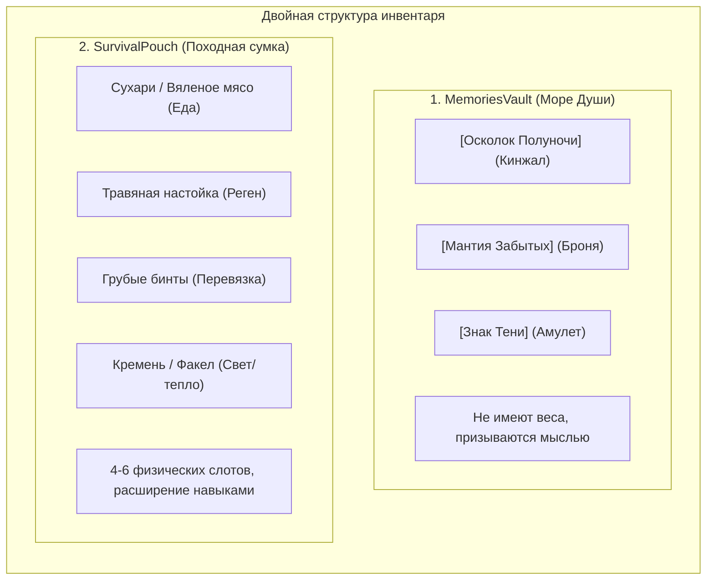

# Дизайн-документ: Инвентарь, экономика и расходуемые предметы (Inventory, Economy & Consumables)

**Проект:** Shadow Slave (3D Action-RPG / Survival)  
**Статус:** Утверждено ведущим разработчиком (Этап 12, Milestone 9)  
**Файл документа:** `docs/design/inventory_economy_and_consumables.md`  
**Опорные документы:**
- `docs/DECISIONS.md` — журнал архитектурных решений;
- `docs/production/open_questions.md` — решения по лечению и расходникам;
- `docs/design/systems_integration.md` — системная интеграция.

---

## 1. Концепция двойного инвентаря

Инвентарь строго разделен на два изолированных слоя, исключающих смешивание магических Воспоминаний и физических пожитков:

### 1.1. Хранилище Воспоминаний (`MemoriesVault`)
- Управляется через интерфейс Заклинания Кошмара;
- Воспоминания не имеют веса;
- Призыв и отзыв оружия происходят мгновенно в виде световых искр.

### 1.2. Походная сумка выживания (`SurvivalPouch`)
- Базовая вместимость: 4 слота (расширяется до 6 слотов навыком *«Привычный к лишениям»*);
- Хранит только физические расходуемые предметы, факелы и квестовые улики;
- Защищает от перегруза и абсурдного накопления десятков предметов в карманах туники.

---

## 2. Модель лечения и расходуемых предметов

В соответствии с утвержденным решением принята **ведьмачья модель постепенной регенерации с редкими экстренными артефактами**:

### 2.1. Постепенная регенерация (Основной способ лечения)
- **Еда (Сухари, сушеное мясо):** Дает мягкую фоновую регенерацию (1 HP/сек в течение 30 секунд). Действует вне боя и во время боя, восполняя силы.
- **Травяные настойки (Аналог «Ласточки»):** Ускоренная регенерация (3 HP/сек в течение 20 секунд).
- **Связь с древом навыков:** Навык *«Метаболизм трущоб»* продлевает время действия регенерации на 30/60/100%.

### 2.2. Экстренное мгновенное исцеление (Редкие тайники)
- **Искры Исцеляющей Памяти / Кристаллы Жизни:**
  - Восстанавливают 50% максимального здоровья мгновенно;
  - **Критическое ограничение:** Их невозможно купить или скрафтить в лагере;
  - Добываются **исключительно как награда за исследование секретов**, обход смертельных ловушек и решение пространственных головоломок;
  - Количество таких предметов на локацию строго ограничено (1–2 штуки на акт), что делает их применение осознанным стратегическим решением.

---

## 3. Экономика и торговля: Контекстный бартер

### 3.1. Торговля в Первом Кошмаре
В суровых условиях каравана рабов и заснеженного пика **нет традиционных магазинов с торговцами золотом**.
- Реализуется **ситуативный бартер через систему диалогов**:
  - Обмен найденного куска кремня на сухую ветошь у соседа по цепи;
  - Передача пайки надсмотрщику в обмен на ослабление кандалов;
  - Бартер не требует сложного магазинного интерфейса и оформляется через контекстные ветки диалога.

### 3.2. Полноценная экономика (Мирные хабы)
Классические торговцы, валюта (кредиты в NQSC или осколки душ в Царстве Снов) и магазины отложены до этапов мирных городов и поселений Пробужденных.

---

## 4. Градация внедрения: Необходимое vs Желательное vs Будущее

- **MVP (Ближайший играбельный срез S2):**
  - Компонент `SurvivalPouch` с 4 слотами;
  - Логика эффекта `RegenEffect` у еды (плавное восстановление HP);
  - 1 редкий предмет мгновенного исцеления в секретной зоне тестового уровня.
- **Качественное демо (S3–S4):**
  - Взаимодействие сумки с веткой навыков «Выживание» (расширение слотов, длительность);
  - Диалоговый бартерный обмен предметами в лагере рабов.
- **Долгосрочно (Пост-демо / Релиз):**
  - Полноценная магазинная торговля в мегаполисе NQSC;
  - Расширенный алхимический крафт настоек и мазей на костре.
