# Дизайн-документ: Древо навыков и система прогрессии (Skill Tree & Progression)

**Проект:** Shadow Slave (3D Action-RPG / Survival)  
**Статус:** Утверждено ведущим разработчиком (Этап 12, Milestone 9)  
**Файл документа:** `docs/design/skill_tree_and_progression.md`  
**Опорные документы:**
- `docs/DECISIONS.md` — журнал архитектурных решений;
- `docs/production/open_questions.md` — решения по прогрессии;
- `docs/story/canon_research.md` — канон Заклинания Кошмара, ранги, ядро души и осколки;
- `docs/design/systems_integration.md` — общая архитектура интеграции систем.

---

## 1. Концепция и канонический фундамент

### 1.1. Отказ от абстрактных уровней персонажа
В соответствии с каноном романа *Shadow Slave* (гл. 0–2) в игре **полностью отсутствуют числовые уровни персонажа (Level 1..100)** и опыт (XP). Заклинание Кошмара не присваивает уровни за убийство монстров.

### 1.2. Два взаимосвязанных столпа развития
Прогрессия персонажа делится на два взаимодополняющих слоя:
1. **Каноническое насыщение Ядра Души (Soul Core Saturation):**
   - Санни начинает как Аспирант со Спящим Ядром (Rank: Aspirant, Core: Dormant).
   - Поглощение Осколков Душ (Soul Shards, 0..100) укрепляет физическую стойкость тела (прирост базового пула здоровья и выносливости).
2. **Древо навыков и стилей по модели *The Witcher 3*:**
   - Практическое развитие приемов, ловкости, теневого чутья и навыков выживания.
   - Развитие не дает абстрактных нереалистичных бонусов, а улучшает конкретные физические и тактические аспекты поведения Санни.

### 1.3. Источники Очков Рунического Мастерства (Mastery Points)
Очки для прокачки древа навыков зарабатываются двумя путями:
- **Рубежи насыщения Ядра Души:** достижение отметок в 10, 25, 50, 75 и 100 поглощенных осколков душ открывает по 1 очку Мастерства от Заклинания.
- **Монолиты Заклинания (Runic Monoliths):** древние рунические стелы и памятники, скрытые в труднодоступных уголках локаций (аналог Мест Силы). Взаимодействие с ними дает 1 очко Мастерства.

---

## 2. Структура древа навыков: 4 специализированные ветки

Древо представлено в интерфейсе рун Заклинания четырьмя отдельными ветками по 4–5 навыков в каждой. Каждый навык имеет от 1 до 3 рангов улучшения.

```mermaid
graph TD
    subgraph Tree ["Древо навыков Санни (Witcher 3 Model)"]
        subgraph Melee ["Ветка 1: Ближний бой (Combat / Melee)"]
            M1["Быстрый выпад (1-3)<br/><i>Скорость атаки ножом +10/20/30%</i>"]
            M2["Экономный замах (1-2)<br/><i>Расход выносливости -15/30%</i>"]
            M3["Парирование лезвием (1-3)<br/><i>Окно парирования +0.1с, срез урона</i>"]
            M4["Смертоносный разрез (1-2)<br/><i>Урон по уязвимым зонам +25/50%</i>"]
            M1 --> M2 --> M3 --> M4
        end

        subgraph Agility ["Ветка 2: Ловкость и Дальний бой (Ranged / Agility)"]
            A1["Мягкая поступь (1-3)<br/><i>Радиус шума шагов -25/50/75%</i>"]
            A2["Маневренный отскок (1-2)<br/><i>Дистанция Dash +20%, i-frames +0.05с</i>"]
            A3["Бросок из тени (1-2)<br/><i>Дальность и урон метания камней/ножей</i>"]
            A4["Удар исподтишка (1-3)<br/><i>Стелс-множитель со спины x2 -> x3 -> x4</i>"]
            A1 --> A2 --> A3 --> A4
        end

        subgraph ShadowBranch ["Ветка 3: Теневое восприятие (Shadow / Awareness)"]
            S1["Чуткая Тень (1-3)<br/><i>Радиус обнаружения врагов Тенью +3/6/10м</i>"]
            S2["Теневой свист (1-2)<br/><i>Приманка врагов шумом в выбранную точку</i>"]
            S3["Шепот опасности (1-2)<br/><i>Визуальный маркер подготовки удара врага</i>"]
            S4["Теневая фиксация (1-2)<br/><i>Тень задерживает внимание врага на 2-3с</i>"]
            S1 --> S2 --> S3 --> S4
        end

        subgraph SurvivalBranch ["Ветка 4: Общие навыки выживания (General / Survival)"]
            G1["Привычный к лишениям (1-2)<br/><i>Вместимость походной сумки +1/+2 слота</i>"]
            G2["Метаболизм трущоб (1-3)<br/><i>Длительность действия еды и настоек +30/60/100%</i>"]
            G3["Закалка окраин (1-2)<br/><i>Сопротивление морозу и токсинам +25/50%</i>"]
            G4["Быстрое дыхание (1-3)<br/><i>Скорость регенерации выносливости +15/30/45%</i>"]
            G1 --> G2 --> G3 --> G4
        end
    end
```



---

## 3. Описание навыков и их связь с геймплеем

### Ветка 1: Ближний бой (Combat / Melee)
- **Фокус:** Повышение эффективности фехтования легким клинком/кинжалом.
- **Взаимодействие с боем:** Напрямую модифицирует параметры `AttackStats` и `MeleeAttack` (время `windup`, расход выносливости, окно парирования).

### Ветка 2: Ловкость и Дальний бой (Ranged / Agility)
- **Фокус:** Скрытное перемещение, позиционирование и маневренность.
- **Взаимодействие со стелсом:** Снижает дистанцию реакции ИИ на шаги Санни; усиливает урон при атаке нетревожного противника из засады; удлиняет окно неуязвимости при уклонении (Dash).

### Ветка 3: Теневое восприятие (Shadow / Awareness)
- **Фокус:** Раскрытие потенциала связи с Тенью как тактическим спутником.
- **Взаимодействие со способностями:** Увеличивает дальность разведки Тенью; добавляет возможность издавать отвлекающий звук; выводит индикатор опасности на экран при замахе противника из слепой зоны.

### Ветка 4: Общие навыки выживания (General / Survival)
- **Фокус:** Адаптация к суровым условиям холода, голода и ограниченности ресурсов.
- **Взаимодействие с инвентарем и лечением:** Увеличивает физические слоты сумки `SurvivalPouch`; продлевает время плавной регенерации HP от сухпайков и настоек; защищает от штрафов замерзания.

---

## 4. Техническая реализация в Godot (Resource-Driven)

Система строится на базе типизированных ресурсов `.tres`:

```gdscript
# skill_node.gd (Resource)
class_name SkillNode
extends Resource

@export var id: StringName
@export var title: String
@export_multiline var description: String
@export var branch: StringName # &"melee", &"agility", &"shadow", &"survival"
@export var max_rank := 3
@export var current_rank := 0
@export var required_shard_threshold := 0
@export var prerequisite_skill_id: StringName = &""
```

```gdscript
# skill_tree_data.gd (Resource)
class_name SkillTreeData
extends Resource

@export var available_mastery_points := 0
@export var skills: Dictionary = {} # id -> SkillNode

func can_unlock(skill_id: StringName) -> bool:
    # Проверка очков и пререквизитов
    ...

func unlock_rank(skill_id: StringName) -> bool:
    # Повышение ранга и испускание сигнала
    ...
```

---

## 5. Градация внедрения: Необходимое vs Желательное vs Будущее

- **MVP (Ближайший играбельный срез S2):**
  - Структура ресурса `SkillTreeData` и хранение очков;
  - 4 базовых стартовых навыка (по 1 в каждой ветке: *«Экономный замах»*, *«Мягкая поступь»*, *«Чуткая Тень»*, *«Метаболизм трущоб»*);
  - Интеграция модификаторов в контроллер и расходники.
- **Качественное демо (S3–S4):**
  - Полная сетка древа (16 навыков) в интерфейсе `RuneStatusUI`;
  - Начисление очков за рубежи поглощения осколков душ (10, 25, 50...);
  - Интерактивные монолиты в мире с выдачей очков.
- **Долгосрочно (Пост-демо / Релиз):**
  - Синергия веток и создание гибридных комбо-навыков;
  - Эволюция древа после Пробуждения Аспекта (открытие теневой магии).
