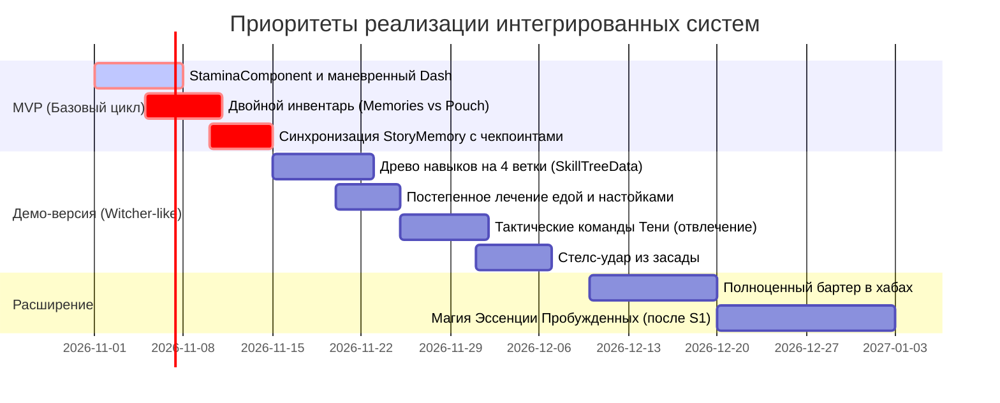

# Архитектурный документ: Интеграция игровых систем и аудит совместимости

**Проект:** Shadow Slave (3D Action-RPG / Survival)  
**Этап разработки:** Этап 11 (Milestone 8, с актуализацией решений Пакета 1)  
**Статус документа:** Концепция утверждена к поэтапной реализации  
**Файл документа:** `docs/design/systems_integration.md`  
**Опорные документы:**
- `docs/DECISIONS.md` — журнал архитектурных решений Godot 4.7.2;
- `docs/production/open_questions.md` — утвержденные развилки ведущего разработчика (Пакет 1);
- `docs/story/canon_research.md` — канон Заклинания, Аспекты, Воспоминания, Осколки Душ, Изъян Санни;
- `docs/story/vertical_slice_plan.md` и `docs/production/vertical_slice_production_plan.md` — план вертикального среза;
- `docs/design/dialogue_system.md` — концепция диалогов и взаимодействия с NPC;
- Существующие скрипты: `scripts/combat/*`, `scripts/player/*`, `scripts/dialogue/*`, `scripts/interaction/*`, `scripts/spell/*`.

---

## 1. Введение и цели интеграции

На предыдущих этапах были сформированы концептуальные контуры ключевых подсистем:
1. Прогрессия и навыки персонажа;
2. Способности Аспекта, атрибуты и Воспоминания (Memories);
3. Боевая система (фазы удара, выносливость, хёртбоксы);
4. Инвентарь, ресурсы выживания и расходные предметы;
5. Диалоговая система и взаимодействие с NPC.

**Цель настоящего документа** — объединить эти механики в целостный, непротиворечивый игровой цикл класса **Action-RPG с элементами выживания в стиле *The Witcher 3*** (повышенная сложность, тактическая свобода билдов, стелс и подготовка), ликвидировать архитектурные конфликты, установить жесткие правила владения данными (Single Source of Truth) и определить приоритеты разработки от MVP до релиза.

---

## 2. Схема взаимосвязей игровых систем

Архитектура строится на принципе слабосвязанных модулей (Loose Coupling), взаимодействующих через сигналы движка Godot и единый слой данных состояния персонажа.

```mermaid
graph TD
    subgraph Data Layer ["Слой данных и состояния (Single Source of Truth)"]
        CharSheet["SoulState & CharacterSheet<br/>(Ядро, Осколки, HP, Выносливость)"]
        SkillTreeData["SkillTreeData (.tres)<br/>(4 ветки навыков, Очки Мастерства)"]
        MemoriesInv["MemoriesVault<br/>(Призванные Воспоминания)"]
        PouchInv["SurvivalPouch<br/>(Физические предметы, пайки, бинты)"]
        StoryMem["StoryMemory<br/>(Флаги диалогов, квестов, решений)"]
    end

    subgraph Core Loop ["Геймплейные подсистемы"]
        WorldExploration["Исследование и выживание<br/>(Секреты, мороз, разведка Тенью)"]
        CombatSystem["Боевая система (Action-RPG / Witcher-like)<br/>(MeleeAttack, Hurtbox, Dodge, Stamina)"]
        ShadowAbilities["Способности Аспекта<br/>(Управление Тенью, отвлечение врагов, чутье)"]
        InteractionDialogue["Диалоги и взаимодействия<br/>(DialogueRunner, SubtitleUI, ChoiceUI)"]
        SpellInterface["Интерфейс Заклинания<br/>(RuneStatusUI, Древо рун, SpellMessageUI)"]
    end

    subgraph Progression ["Контур развития"]
        SoulRefinement["Насыщение Ядра Души<br/>(Поглощение Осколков Душ)"]
        MasteryAcquisition["Очки Рунического Мастерства<br/>(Рубежи осколков + Монолиты)"]
    end

    %% Взаимосвязи
    WorldExploration -->|Обнаружение врагов/лута/секретов| CombatSystem
    CombatSystem -->|Расход выносливости / Урон| CharSheet
    CombatSystem -->|Победа над монстром| SoulRefinement
    CombatSystem -->|Материализация оружия| MemoriesInv
    
    ShadowAbilities -->|Тактическая разведка / Отвлечение| CombatSystem
    ShadowAbilities -->|Осведомленность| WorldExploration

    SoulRefinement -->|Насыщение ядра (0..100)| CharSheet
    SoulRefinement -->|Рубежи осколков (10, 25...)| MasteryAcquisition
    WorldExploration -->|Нахождение Монолитов| MasteryAcquisition
    MasteryAcquisition -->|Вложение в 4 ветки навыков| SkillTreeData
    SkillTreeData -->|Пассивные и боевые модификаторы| CombatSystem
    SkillTreeData -->|Длительность еды / вес сумки| PouchInv

    InteractionDialogue -->|Запись решений и фактов| StoryMem
    StoryMem -->|Условия реплик и доступ к квестам| InteractionDialogue
    PouchInv -->|Использование еды / бинтов / редких зелий| WorldExploration
    PouchInv -->|Бартер с NPC| InteractionDialogue

    CharSheet -->|Отображение рун| SpellInterface
    MemoriesInv -->|Список в интерфейсе рун| SpellInterface
    SkillTreeData -->|Визуализация древа навыков| SpellInterface
```

---

## 3. Согласованный игровой цикл (Core Gameplay Loop)

Игровой процесс строится вокруг цикла **«Выживание -> Тактическая оценка и Тень -> Свободный выбор подхода (Бой / Стелс) -> Сбор наград и осколков -> Привал, регенерация и прокачка»**.

```mermaid
sequenceDiagram
    autonumber
    actor Player as Игрок (Санни)
    participant World as Мир / Локация
    participant Shadow as Тень (Child of Shadows)
    participant Combat as Боевая система (Action-RPG)
    participant Spell as Заклинание / Ядро Души
    participant NPC as NPC / Диалоги

    Note over Player, World: 1. Исследование и выживание
    Player->>World: Передвижение в режиме FREE (холод, поиск тайников)
    Player->>Shadow: Отправка Тени на разведку за угол / чутье опасности
    Shadow-->>Player: Обнаружен караульный монстр; Тень отвлекает его шумом

    Note over Player, Combat: 2. Выбор подхода: Стелс или Прямой бой
    alt Скрытная ликвидация (Стелс)
        Player->>Combat: Бесшумный подход со спины -> критический удар кинжалом
    else Открытый маневренный бой (Witcher-like)
        Player->>Spell: Мгновенный призыв клинка из Моря Души
        Player->>Combat: Серия быстрых ударов, маневренные уклонения (запас 5-6 ударов)
    end
    Combat-->>Player: Победа над врагом

    Note over Player, Spell: 3. Сбор наград, поглощение осколков и тайники
    World->>Spell: Искры Осколков Душ устремляются к Санни (+Осколки Душ)
    World->>Player: В тайнике найден редкий кристалл мгновенного исцеления
    Spell->>Spell: Достигнут рубеж 25 осколков -> открыто очко Мастерства

    Note over Player, NPC: 4. Привал, регенерация и вложение навыков
    Player->>Player: Употребление сушеного пайка -> запуск постепенной регенерации HP
    Player->>Spell: Экран рун: вложение очка в «Длительность действия еды»
    Player->>NPC: Разговор с рабом (режим LOOK) с учетом Изъяна [Clear Conscience]
```

### Правила невмешательства подсистем (Decoupling Invariants)
1. **Бой не зависит от грид-инвентаря:** Оружие призывается горячей клавишей; во время боя игрок не занимается менеджментом ячеек рюкзака.
2. **Диалоги не меняют боевые параметры напрямую:** Диалог изменяет сюжетные флаги или передает предметы; характеристики обновляются только через `CharacterSheet` и `SkillTreeData`.
3. **Физический инвентарь не управляет Воспоминаниями:** Походная сумка работает только с физическими расходниками выживания; Воспоминания управляются исключительно через модуль `MemoriesVault`.

---

## 4. Реестр устраненных противоречий и утвержденные механики

### 4.1. Дерево навыков: «Ведьмачья модель» без числовых уровней
- **Проблема:** Классическое RPG-древо с очками за уровни героя ломает канон Заклинания, где уровней нет.
- **Утвержденное решение:**
  - Числовые уровни (Level 1..100) отсутствуют;
  - Полноценное дерево навыков строится по модели *The Witcher 3* и разбито на 4 специализированные ветки:
    1. **Ближний бой (Combat / Melee):** приемы владения кинжалом/мечом, быстрые связки, своевременное парирование, снижение расхода выносливости на взмахи;
    2. **Дальний бой и ловкость (Ranged / Agility):** броски камней и ножей, бесшумный шаг, скорость спринта, дальность шага уклонения;
    3. **Теневое восприятие (Shadow / Awareness):** радиус теневого чутья, скрытность в темных зонах, обнаружение слабостей врагов Тенью;
    4. **Общие навыки выживания (General / Survival):** переносимый вес походной сумки, длительность действия еды и настоек, сопротивление морозу, эффективность отдыха.
  - **Получение очков навыков:** Очки Рунического Мастерства (Mastery Points) даются не за абстрактный «опыт», а за каноническое поглощение Осколков Душ (рубежи 10, 25, 50, 75, 100 осколков) и нахождение древних рунических памятников / монолитов Заклинания.

### 4.2. Роль Тени в бою: Тактический ассистент
- **Проблема:** В Первом Кошмаре Санни — Аспирант со Спящим Ядром (Dormant), у него нет Эссенции Души (маны) для боевых заклинаний.
- **Утвержденное решение:** Тень выступает тактическим разведчиком и вспомогательным агентом:
  - Разведка за углами без риска для персонажа;
  - Пассивное чутье опасности (предупреждение о готовящемся ударе со спины);
  - Создание отвлекающего шума для увода караульных монстров;
  - Содействие скрытным убийствам из тени.

### 4.3. Боевая сложность: Маневренный Action-RPG баланс
- **Проблема:** Чрезмерно хардкорный соулслайк с ваншотами сковывает свободу отыгрыша и навязывает единственный стиль игры.
- **Утвержденное решение:**
  - Баланс летальности настроен на **5–6 ударов рядового противника до гибели Санни**;
  - Управление отзывчивое, анимация замаха может быть прервана своевременным уклонением (Dash);
  - Игрок свободен в выборе билда: прямое контактное фехтование, стелс-прохождение или подготовка ловушек и расходников.

### 4.4. Лечение и расходники: Постепенная регенерация + редкие экстренные артефакты
- **Проблема:** С одной стороны, спам зелий ломает вызов боя; с другой стороны, полный запрет любого лечения в бою чрезмерно фрустрирует.
- **Утвержденное решение:**
  - **Основной способ лечения:** Постепенная регенерация здоровья во времени от употребления пищи и целебных настоек (аналог «Ласточки» и еды в Ведьмаке). Ветка «Выживание» увеличивает время действия и скорость притока HP;
  - **Мгновенное лечение:** Существует в виде редчайших Воспоминаний-артефактов (осколки исцеляющей памяти), которые невозможно купить. Они добываются только при тщательном исследовании тайников и решении сложных головоломок.

### 4.5. Дублирование экипировки: Разделение инвентарей
- **Утвержденное решение:**
  - `MemoriesVault` — духовные Воспоминания Заклинания (оружие, броня), не имеющие физического веса и призываемые из души;
  - `SurvivalPouch` — ограниченные слоты под физические предметы реального мира (факел, вода, кремень, веревка).

---

## 5. Правила владения данными персонажа (Single Source of Truth)

| Параметр / Состояние | Единственный владелец (Source of Truth) | Читатели | Модификаторы |
|---|---|---|---|
| **Текущее / Макс. HP** | `HealthComponent` (узел Санни) | `CombatHud`, `SunnyController`, `SliceDirector` | `MeleeAttack` (урон), Регенерация еды, Редкие артефакты |
| **Выносливость (Stamina)** | `StaminaComponent` | `SunnyController`, `CombatHud` | Спринт, удары, уклонения, навыки ветки «Бой» |
| **Ядро Души и Осколки** | `SoulCoreData` (Resource `.tres`) | `RuneStatusUI`, `SpellMessageUI` | Награды за убийство монстров (0..100) |
| **Дерево навыков и Очки** | `SkillTreeData` (Resource `.tres`) | `RuneStatusUI`, Контроллер, Сумка | Насыщение ядра, Нахождение монолитов |
| **Воспоминания (Memories)** | `MemoriesVault` (Resource `.tres`) | `RuneStatusUI`, Экипировка в бою | Триумфы Заклинания |
| **Физический инвентарь** | `SurvivalPouch` (Component) | `InventoryUI`, `Interactable` | Сбор лута, крафт, бартер, навыки ветки «Выживание» |
| **Сюжетные флаги** | `StoryMemory` (Blackboard) | `DialogueRunner`, `QuestManager` | Выбор в диалогах; откат через `CheckpointManager` |

---

## 6. Минимальная спецификация подсистем

### 6.1. Боевая система (Action-RPG)
- **Компоненты:** `HealthComponent`, `Hurtbox`, `MeleeAttack`, `StaminaComponent`.
- **Характеристики:** Запас прочности 5–6 ударов, маневренный Dash с окном неуязвимости (i-frames 0.2 с), возможность прерывания замаха отскоком в фазе Windup.
- **Стелс:** Множитель урона x3 при атаке со спины нетревожного противника.

### 6.2. Прогрессия и Дерево навыков
- **Ресурс `SkillTreeData`:**
  - Сетка из 4 веток по 4–5 навыков в каждой;
  - Навыки имеют от 1 до 3 рангов улучшения;
  - Примеры навыков:
    - *«Быстрый клинок»* (снижение расхода выносливости на удары на 10/20/30%);
    - *«Чутье бездны»* (увеличение радиуса обнаружения угроз Тенью);
    - *«Привычный к лишениям»* (увеличение переносимого веса сумки на 2 слота);
    - *«Метаболизм трущоб»* (продление действия пищи на 50/100%).

### 6.3. Способности Тени
- **Функционал:**
  - `scout_mode`: отделение камеры и управление силуэтом Тени в радиусе 15 метров;
  - `shadow_whistle`: отвлечение внимания врага звуком в выбранной точке;
  - `backstab_assist`: Тень фиксирует внимание противника на 2 секунды.

### 6.4. Инвентарь и расходники
- **`SurvivalPouch`:** 6 базовых слотов под физические предметы выживания.
- **Еда и настойки:** Обеспечивают регенерацию 1–2 HP в секунду в течение 30–60 секунд.
- **Редкие артефакты:** Мгновенное восстановление 50% HP (строго ограниченное число на игру, награда за тайники).

---

## 7. Дорожная карта и приоритеты разработки



---

## 8. Необходимые анимации и визуальные ресурсы

Для реализации утвержденной концепции формируется строгий реестр ассетов, предотвращающий раздувание бюджета:

### 8.1. Минимальный набор анимаций персонажа (8 клипов)
1. `1H_Attack_Light_Slash` — быстрый колющий/режущий выпад ножом (0.35 с);
2. `1H_Attack_Heavy_Thrust` — силовой удар с подготовкой (0.6 с);
3. `Dodge_Hop` — маневренный шаг/отскок уклонения с i-frames 0.2 с (0.4 с);
4. `1H_Block_Pose` — защитная стойка клинком;
5. `Stealth_Stab` — скрытный удар со спины из засады (1.2 с);
6. `Hit_Light` — реакция на легкое попадание (без прерывания атаки);
7. `Exhausted_Gasp` — замедленная одышка при нулевой выносливости;
8. `Death_A` — финальное падение при гибели.

### 8.2. Визуальные эффекты (VFX)
- **Искры поглощения Осколков Душ:** поток мелких белых и багровых частиц, устремляющихся к груди Санни после гибели врага;
- **Материализация Воспоминания:** вспышка черного теневого света и угольного дыма при призыве клинка;
- **Индикатор опасности со спины:** приглушенная дуга/вспышка у края экрана от шепота Тени;
- **Тень-двойник:** полупрозрачный черный силуэт на земле и поверхностях с возможностью отрыва от ног Санни.

---

## 9. Ключевые технические риски и способы их минимизации

| Риск | Вероятность | Влияние | Способ минимизации |
|---|---|---|---|
| **Рассинхрон анимации и фаз атаки при отмене уклонением (Dash Cancel)** | Средняя | Высокое | Окно отмены жестко привязано к таймингу фазы `WINDUP`. При входе в `ACTIVE` отмена блокируется до фазы `RECOVERY`. |
| **Усложнение ИИ при интеграции отвлечения Тенью** | Средняя | Среднее | ИИ противников не просчитывает сложную навигацию: Тень просто создает временную точку звука `SoundAlertNode` (Area3D), переводящую противника в состояние INVESTIGATE. |
| **Поломка баланса из-за стака эффектов регенерации еды** | Высокая | Высокое | Правило исключения: эффекты регенерации одинакового типа не суммируются, а обновляют таймер действия. |
| **Рассинхрон флагов диалогов при смерти персонажа** | Высокая | Критическое | `StoryMemory` делает моментальный снимок (Snapshot) при активации контрольной точки и принудительно восстанавливает его при вызове `respawn()`. |

---

## 10. Рекомендуемый порядок реализации (Задачи разработчику)

1. **Задача T1 (Ядро боя и выносливости):** Реализация компонента `StaminaComponent`, привязка к расходу сил в `SunnyController` и интеграция окна отмены (Dash Cancel) в `MeleeAttack`.
2. **Задача T2 (Двойной инвентарь):** Создание компонента `SurvivalPouch` (4–6 слотов под еду и бинты) и ресурса `MemoriesVault` (призыв оружия горячей клавишей).
3. **Задача T3 (Логика регенерации еды):** Реализация тикового эффекта восстановления HP `RegenEffect` у еды и интеграция редкого предмета мгновенного исцеления.
4. **Задача T4 (Древо навыков `SkillTreeData`):** Каркас ресурса древа навыков на 4 ветки и механика открытия рангов за рубежи поглощенных осколков душ.
5. **Задача T5 (Тактический контроллер Тени):** Создание простейшего режима отделения Тени для разведки и отвлечения ИИ врагов.

---

## 11. Оставшиеся нерешенные вопросы (Пакет 2 — На перспективу)

Следующие темы зафиксированы в `docs/production/open_questions.md` и будут вынесены на согласование на последующих этапах:
1. *Штрафы за смерть:* теряет ли Санни часть непоглощенных осколков душ при гибели (механика Bloodstain) или они сохраняются полностью?
2. *Социальный бартер в лагере рабов:* глубина диалоговых веток обмена ресурсами.
3. *Визуальный язык Тени:* отображение контуров врагов сквозь стены при теневом восприятии.

